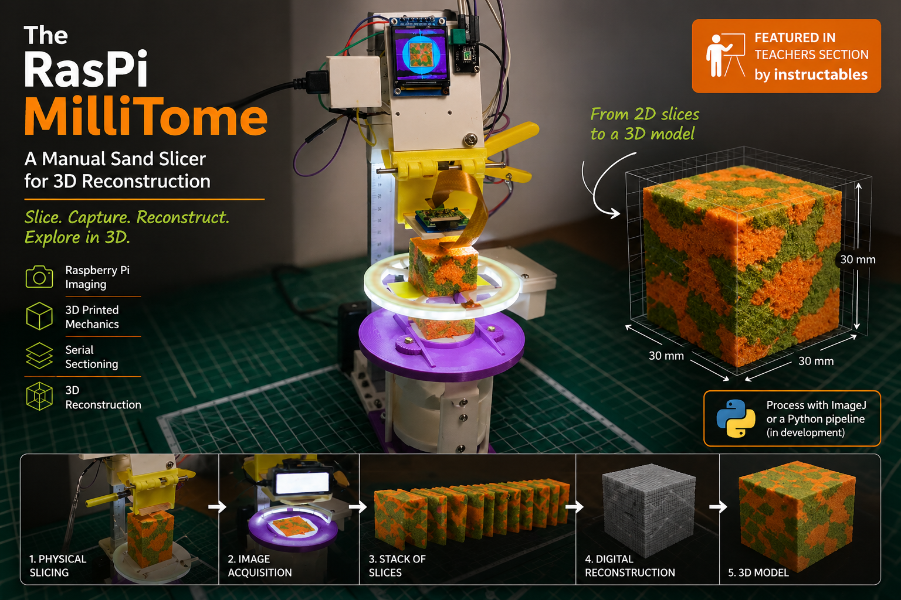

# RasPi MilliTome

A low-cost educational platform for serial sectioning, digital image acquisition, three-dimensional reconstruction and volume estimation.



## Documentation

- [Acquisition and reconstruction manual](docs/Manual.pdf)
- [Camera Module 3 and legacy camera instructions](Acquisition/README_camera_versions.md)
- [Kinetic-sand datasets and processing settings](example_data/KineticSand/README_revision.md)

## Features

- Raspberry Pi image acquisition
- HSV segmentation with a shared native-resolution preview and batch procedure
- Saved ROI, calibration and processing settings, restored automatically from a photo folder
- Sectional-area export and Cavalieri volume estimation
- Three-dimensional visualization and STL export

## Reconstruction

On the analysis computer, use Python 3 with Tk support. Install the reconstruction dependencies from the repository root:

```bash
python3 -m pip install -r requirements.txt
```

Start the application:

```bash
python3 Reconstruction/RasPiMilliTome_Reconstruction.py
```

Select an individual dataset folder with **Load**. A valid `segmentation_params.json` in that folder restores its settings. Inspect the segmentation, then press **Accept ALL** to generate masks, sectional areas and volume. Reprocessing overwrites the generated files, so work on a copy when preserving an earlier analysis.

Use **3D View** to generate a surface before **Export STL**. See the manual for ROI calibration, HSV controls and morphology settings.

## Raspberry Pi acquisition

The current acquisition program supports Camera Module 3 through Picamera2:

```bash
python3 Acquisition/RasPiMilliTome_Picamera2_Focus_v2_GPIO27_Zero2W_Compact.py
```

Run it on the Raspberry Pi with the appropriate camera software. The reconstruction requirements file does not install the complete Raspberry Pi camera environment. See the [camera instructions](Acquisition/README_camera_versions.md) for dependencies, output paths, focus controls and the retained legacy Camera V1.3 program.

## Example data

The quantitative kinetic-sand examples use a recorded 0.6 mm interval:

- [Dataset 1](example_data/KineticSand/Dataset1): orange background, 32 photographs.
- [Dataset 2](example_data/KineticSand/Dataset2): magenta background, 40 photographs.
- [Dataset 3](example_data/KineticSand/Dataset3): magenta background, 40 photographs; illustrated in the manuscript.

Each contains photographs, complete saved settings, masks and a sectional-area CSV. Use each dataset's own JSON to reproduce its archived analysis; ROI and physical calibration are dataset-specific. The [dataset summary](example_data/KineticSand/README_revision.md) gives settings and volumes.

A separate [marble-cake example](example_data/MarbleCake) contains 20 photographs for exploring serial-section reconstruction.

## Associated manuscript

Danilo Roccatano, *The RasPi MilliTome: a low-cost laboratory platform for serial sectioning, three-dimensional reconstruction and volume estimation*.

## Licence

See [LICENSE](LICENSE).
